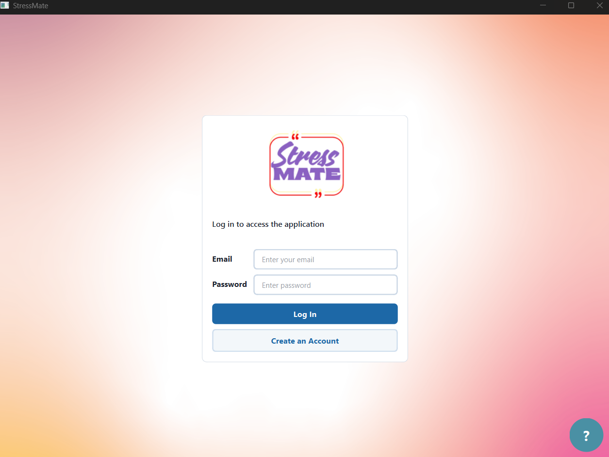
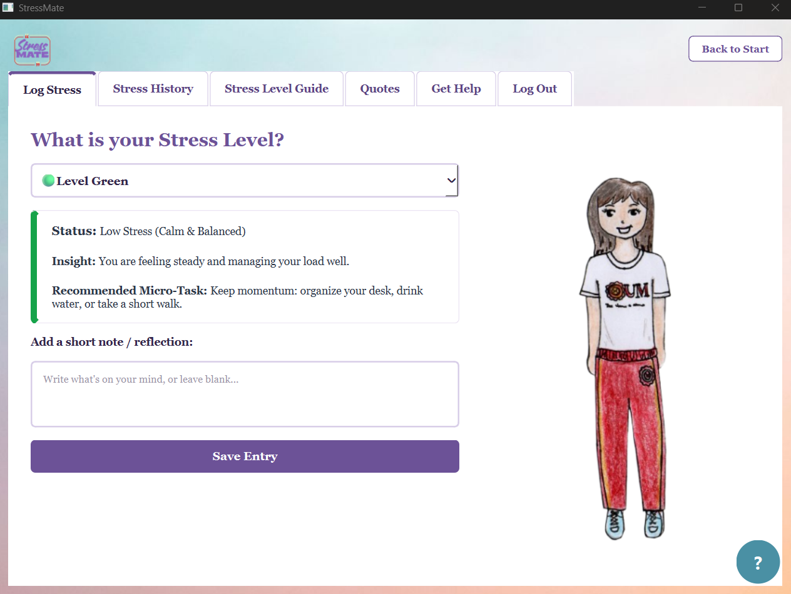
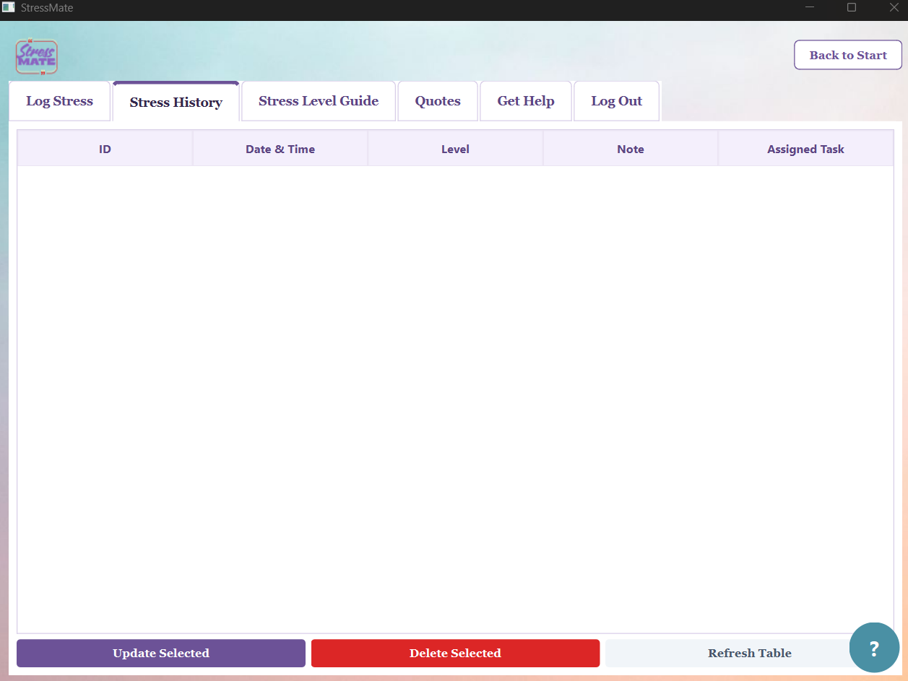
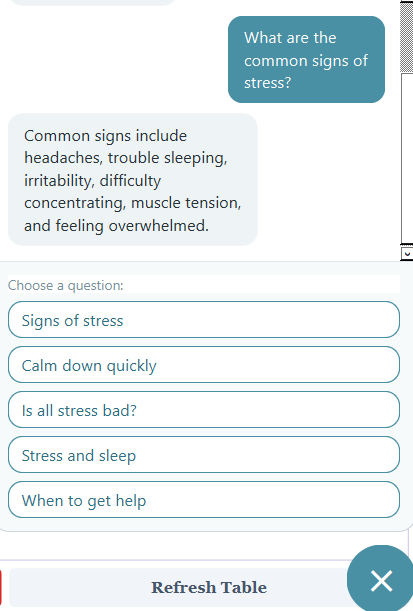

# StressMate: Stress Tracker

## 1. Project Description

StressMate is an interactive application designed to help users track their daily stress levels, reflect on their emotions through journaling, and receive actionable coping strategies tailored to their current mental state.

With the increasing demands of academic and professional life, many individuals experience burnout and anxiety without knowing how to pause or manage it. StressMate provides an organized space to log feelings and offering techniques (like the 4-7-8 breathing method or micro-tasks) to intercept extreme stress before it escalates.

## 2. Project Objectives

- To provide daily stress logging and emotional reflection.
- To offer actionable advice and micro-tasks dynamically tailored to the user's specific stress tier (Green, Yellow, Orange, Red).
- To maintain a secure database of user accounts and their emotional history, allowing users to look back and manage their well-being over time.
- To answer common questions about stress instantly and point users to real help when they need it.

## 3. Features

- **Secure User Authentication:** A login and registration system featuring strict password validation (minimum length, uppercase, and numerical requirements) and secure SHA-256 password hashing.
- **Interactive Stress Logging:** Users can categorize their current stress into four color-coded tiers and add personal reflection notes to record their daily mental state.
- **History Management (CRUD):** Users can view, update, and delete their past stress logs in a structured data table.
- **Coping & Support Resources:** Dedicated informative modules broken down into Physical, Emotional, and Spiritual help, providing specific grounding techniques and actionable advice.
- **Inspirational Quotes Album:** An interactive image gallery providing users with uplifting quotes and visual encouragement.
- **Stress FAQ Chat Box:** A chat box in the bottom-right corner of every screen. Users tap one of five common questions and get an answer in a chat-style reply. It uses pre-written answers, so it works offline and needs no AI or internet connection.

## 4. Emergency & Support Resources

> **Important:** StressMate is a self-help tool and **not** a substitute for professional care. If you or someone you know is in immediate danger, call **911** (Philippine national emergency hotline) right away.

These helplines are free and confidential, and are listed as verified on [Find A Helpline](https://findahelpline.com/countries/ph).

| Helpline | Contact | Description |
| --- | --- | --- |
| **[NCMH Crisis Hotline](https://findahelpline.com/organizations/ncmh-crisis-hotline)** | **1800-1888-1553** (toll-free) | 24/7 free and confidential phone support from trained counselors, run by the National Center for Mental Health. Open to anyone dealing with stress, anxiety, depression, or thoughts of self-harm. |
| **[In Touch: Crisis Line](https://www.in-touch.org/)** | **+63 2 8893 7603** | 24/7 free and confidential phone support from trained volunteers. A good place to talk through overwhelming emotions or loneliness. |
| **[HOPELINE](https://www.facebook.com/HopelinePH/)** | **(02) 8804-4673** | 24/7 free and confidential phone support from counselors for anyone in the Philippines who needs someone to listen. |

More helplines, filtered by topic such as [Stress](https://findahelpline.com/countries/ph/topics/stress), [Anxiety](https://findahelpline.com/countries/ph/topics/anxiety), and [School & work](https://findahelpline.com/countries/ph/topics/school-work), can be found at **[findahelpline.com/countries/ph](https://findahelpline.com/countries/ph)**.

*Hotline details were checked on Find A Helpline in October 2026. Numbers can change, so please confirm on the links above.*

## 5. Technologies Used

- **Programming Language:** Python 3
- **GUI Framework:** PyQt6
- **Database:** SQLite (via the built-in `sqlite3` module)
- **Other Important Libraries:**
  * `hashlib`: For secure password hashing.
  * `re` (RegEx): For validating email formats and strict password rules.
  * `dataclasses`: For structuring clean, object-oriented domain models.
  * `os`: For dynamic and safe asset file path routing.

## 6. Project Structure

- **`/assets/`**: Stores all static media resources, including the application logo, background images, overview infographics, and the quotes image gallery.
- **`/database/`**: Contains `database.py`, which encapsulates the SQLite connection logic and automatically executes the schema creation for the `users` and `stress_logs` tables.
- **`/features/`**: The core directory utilizing a layered Object-Oriented Programming (OOP) architecture. It is divided into four domains: `authentication`, `tracker`, `faq`, and `navigation`.
  * `authentication` and `tracker` are cleanly separated into `model.py` (data structures), `repository.py` (database queries), `service.py` (business logic and validation), and `view.py` (PyQt6 UI rendering).
  * `faq/view.py` holds the floating FAQ chat box (`FaqChatBox`) and its `FaqItem` data model. The FAQ is static content, so it needs no database layer.
  * `navigation/next_button.py` holds the bottom-center `NextPageButton` that guides users to the next page.
- **`main.py`**: The central entry point and orchestrator of the application. It initializes the database, connects the services, adds the FAQ chat box and the next-page button, and uses a `QStackedWidget` to manage screen transitions.

## 7. Installation and Setup

**Dependencies:**

- `PyQt6`

**Steps to Run:**

1. Clone the repository to your local machine.
2. Open a terminal in the project folder.
3. Install PyQt6 by running: `pip install PyQt6`
4. Run the application: `python main.py`

## 8. How to Use the System

1. **Register/Login:** Create a secure account or log in.
2. **Dashboard:** Click "HOW ARE YOU FEELING TODAY?" (or the glowing **"Click here to go to the next page"** button below it) to enter the tracker.
3. **Log Stress:** Select your current stress level, add an optional reflection note, and save.
4. **View History:** Navigate to the History tab to Update or Delete past entries.
5. **Get Support:** Use the Guides, Quotes, and Help tabs for grounding exercises.
6. **Ask a Question:** Click the round **?** button in the bottom-right corner, then tap a question to read the answer. Click it again to close the chat.
7. **Need urgent help?** See [Emergency & Support Resources](#4-emergency--support-resources).

## 9. OOP Implementation

- **Important Classes:** `User`, `StressRecord`, `FaqItem` (Models), `AuthService`, `StressService` (Logic), and `TrackerView`, `FaqChatBox`, `NextPageButton` (UI).
- **Encapsulation:** Database connections and sensitive logic are hidden inside Repository and Service classes, protecting the data from direct manipulation by the UI. The FAQ chat box likewise keeps its question data, chat building, and positioning logic inside its own class.
- **Inheritance:** Our view classes (e.g., `TrackerView`, `AuthView`, `FaqChatBox`) inherit from PyQt6's base `QWidget` and `QMainWindow` classes to acquire window behaviors. `NextPageButton` inherits from `QPushButton`.
- **Polymorphism:** We override default PyQt6 methods (like `__init__` and `eventFilter`) to inject our own custom UI designs, layouts, and behaviors.

## 10. Database

- **Structure:** A lightweight, relational SQLite database (`stressmate.db`).
- **Important Tables:**
  * `users` (Stores `id`, `email`, and hashed `password`).
  * `stress_logs` (Stores `id`, `user_id`, `timestamp`, `level_code`, `note`, and `task`).
- **Major Operations (CRUD):**
  * **Create:** Registering new users and adding new stress logs.
  * **Read:** Verifying login credentials and fetching user history.
  * **Update:** Editing a previous stress reflection note or level.
  * **Delete:** Removing a stress log from the history table.

## 11. Screenshots

-  - The secure authentication screen.
-  - The main stress logging dashboard.
-  - The data table showing CRUD operations.
-  - The dashboard with the FAQ chat button and the "next page" guide button.

## 12. Testing

- **Test 1: Password Validation**
  * *Expected:* System rejects passwords under 7 characters or missing uppercase/numbers.
  * *Actual:* App successfully blocks registration and pops up a Warning Dialog.
- **Test 2: Database Retrieval**
  * *Expected:* When saving a log, it appears immediately in the History Table.
  * *Actual:* The table dynamically refreshes and shows the new Create operation instantly.

## 13. Known Issues / Limitations

- **Local Storage:** The database currently runs locally via SQLite, meaning data is not synced across multiple devices via the cloud.
- **No Password Reset:** Users cannot currently recover a forgotten password through email verification.
- **Static FAQ:** The FAQ chat box only answers its five built-in questions. It does not understand typed questions.

## 14. Author

- **Name:** Hannah Galabo
- **Section:** CS26L - 3581